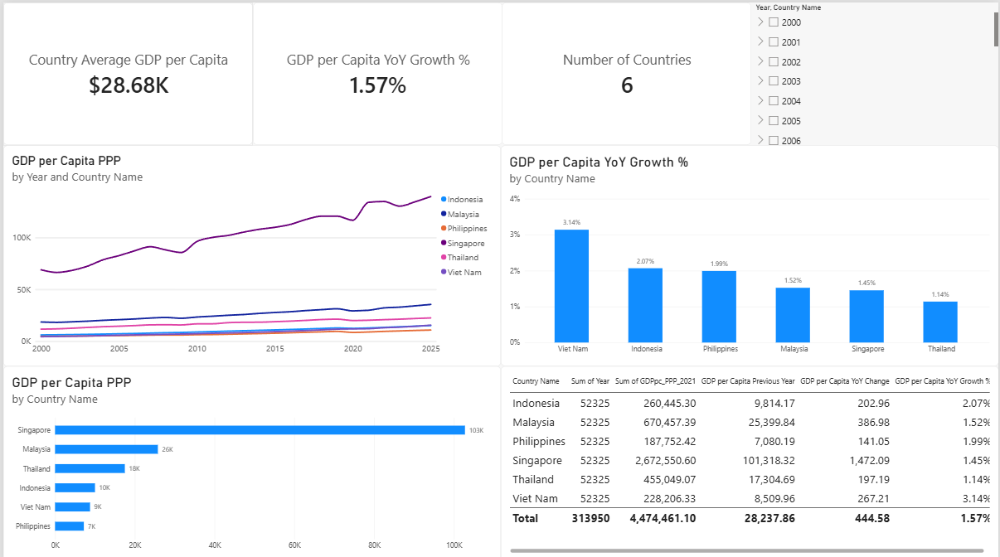

# economic-development-ASEAN-GDP-per-Capita-analysis
Repository about analysis economic development ASEAN GDP per Capita by dataset from World Bank. GDP per capita, PPP (constant 2021 international $). World Development Indicators. https://data.worldbank.org/indicator/NY.GDP.PCAP.PP.KD. Licensed under CC BY 4.0.

# Economic Development dashboard: ASEAN GDP per Capita Aanalysis

## Dashboard Preview

## Business Objective

Analyze Economic development ASEAN GDP per Capita

## Tools Used

- Microsoft Power BI
- Power Query
- DAX

## Key Findings

- Singapore has the highest GDP per capita PPP in every year of the series (rising from ~$69K in 2000 to >$141K in 2025, with a period average of ~$103K) and the largest YoY dollar change (+$1,472.09), while Viet Nam posts the highest YoY percentage growth at 3.14% (overall Country Average GDP per Capita is $28.68K and overall YoY Growth is 1.57% across 6 ASEAN countries)
- Growth is upward overall but fluctuates around external shocks—most notably 2008–2009 and 2020—with absolute dollar gaps widening between Singapore and lower-base peers even as Viet Nam, Indonesia, and the Philippines post higher percentage growth rates
- Key years such as 2008–2009, 2020, and recent years up to 2025 warrant deeper investigation, while strict interpretation rules apply (GDP per capita is not income distribution, household income, or average wage; PPP does not capture full well-being; missing data is not zero; and latest-year coverage must be checked across all countries)

## Recommendations

- Filter by specific years (such as 2008–2009, 2020, and recent years up to 2025) and countries using the slicer to inspect shock impacts and verify whether the latest year is consistently populated across all 6 countries before comparing them
- Pair GDP per capita PPP visuals with complementary socioeconomic indicators (such as income distribution/Gini, household income, and wage statistics) rather than treating PPP averages or chart movements as proof of causation or broad-based household prosperity
- Clean up table column aggregations (such as replacing Sum of Year with a clear year label) and ensure missing values are handled properly as null/blank rather than zero

## Files

- Power BI Dashboard (economic-development-dashboard-ASEAN-GDP-per-capita.pbix)
- Analytical Report (report.txt)
- DAX Measures (Country Average GDP per Capita, GDP per Capita PPP, GDP per Capita Previous Year, GDP per Capita YoY Change, GDP per Capita YoY Growth %, Number of Countries)
- Data Dictionary (FactGDP and DimDate tables, including Country Name, Year, and GDPpc_PPP_2021)

## License

World Bank. GDP per capita, PPP (constant 2021 international $). World Development Indicators. 
https://data.worldbank.org/indicator/NY.GDP.PCAP.PP.KD. Licensed under CC BY 4.0.
